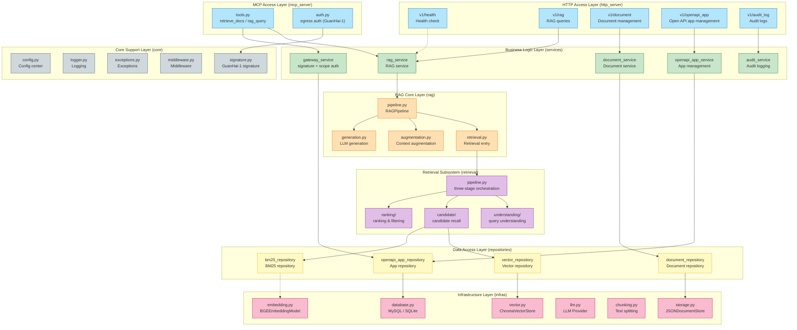
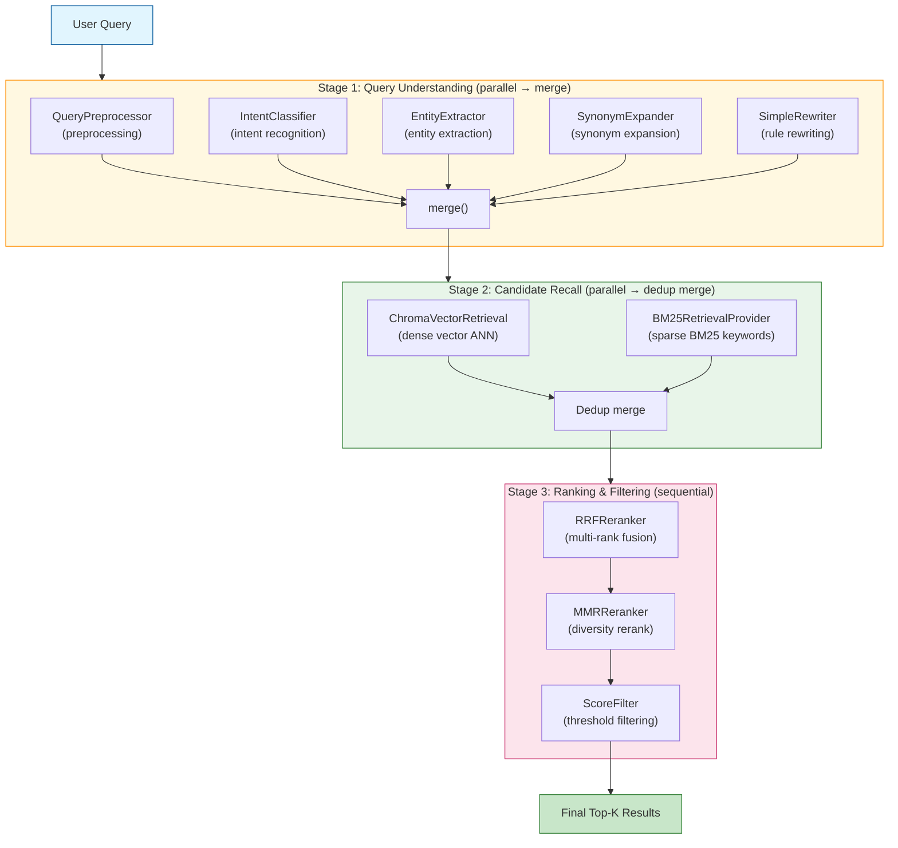
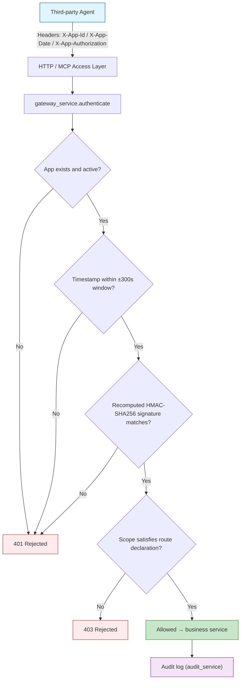

# x-GuanHai


[中文](README.md) | English

## 💡 Introduction

x-GuanHai is a **RAG (Retrieval-Augmented Generation) integrated engineering framework with dual HTTP and MCP mounting** following industry-standard backend engineering practices, providing a layered, modular, highly extensible and maintainable general-purpose service architecture.

**Core Value**

- **Dual-protocol exposure**: the same services are mounted as HTTP APIs (`/api/v1`) and an MCP server (`/mcp`) simultaneously; third-party agents can dynamically discover and call tools through the standard MCP protocol
- **Machine identity security**: pure machine-to-machine authentication for third-party agents (AppId + GuanHai-1 signature + minimal-scope authorization), no human login
- **Layered architecture**: standard five-layer business architecture plus a shared core support layer, fully decoupled from the web framework and reusable across RESTful APIs, MCP tools, offline scripts and unit tests
- **OOP retrieval pipeline**: pluggable three-stage architecture (query understanding, candidate recall, ranking & filtering), each stage supports swappable algorithm providers
- **Multi-channel recall**: dense vector retrieval (Chroma ANN) plus sparse BM25 keyword retrieval in parallel, fused by RRF and diversified by MMR
- **Multi-LLM support**: DeepSeek, Doubao, Aliyun Bailian, Xiaomi Mimo and other mainstream LLM providers
- **Engineering standards**: PEP8 compliance, full type annotations, production-grade logging and exception handling, CI/CD and containerized deployment

**Use Cases**

- Enterprise knowledge base Q&A systems
- Intelligent customer service and conversational bots
- Document retrieval and summarization
- Multi-source data fusion retrieval platforms
- RAG learning and rapid prototyping

## 🚀 Quick Start

**1. Environment Requirements**

| Platform | Requirements |
|----------|--------------|
| **General** | Python 3.11+, Git, [uv](https://github.com/astral-sh/uv) (recommended; avoid pip unless necessary) |
| **Windows** | PowerShell 5.1+; `scripts/start.ps1` included |
| **Linux** | Ubuntu 20.04+ / CentOS 8+; `scripts/start.sh` included |
| **macOS** | macOS 12+; install Python and uv via Homebrew |

**2. Clone the Repository**

```bash
git clone https://github.com/chain-engine/x-GuanHai.git
cd x-GuanHai
```

**3. Install Dependencies**

```bash
# Sync dependencies with uv (recommended)
uv sync

# Include development dependencies
uv sync --group dev
```

**4. Environment Configuration**

The project supports both `.env` environment variables and a `config.yaml` configuration file, with priority: **environment variables > config.yaml > defaults**.

```bash
# Option 1: environment variable template (recommended)
cp .env.example .env          # Windows PowerShell: Copy-Item .env.example .env

# Option 2: configuration file template
cp config.yaml.example config.yaml
```

**Core Configuration Parameters**:

| Parameter | Description | Default |
|-----------|-------------|---------|
| `DEEPSEEK_API_KEY` | LLM provider API key (DeepSeek/Doubao/Bailian/Mimo all supported) | required |
| `EMBEDDING_MODEL` | Embedding model name | `BAAI/bge-m3` |
| `EMBEDDING_DEVICE` | Embedding model device | `cpu` |
| `VECTOR_STORE_PERSIST_DIR` | Vector store persistence directory | `./data/chroma` |
| `TEXT_SPLITTER_STRATEGY` | Text splitting strategy | `recursive` |
| `GENERATION_PROVIDER` | LLM generation provider | `mimo` |
| `GENERATION_MODEL` | LLM generation model | `mimo-v2.6-pro` |
| `OPENAPI_ENABLED` | Open API authentication switch (AppId + GuanHai-1 signature) | `true` |
| `OPENAPI_DB_URL` | Open API auth database URL (MySQL default; SQLite for local) | `mysql+pymysql://...` |
| `AUTH_SECRET_KEY` | Encryption key for app keys, **must be set to a random value in production** | empty (dev fallback) |
| `DEBUG` | Debug mode (enables hot reload when true) | `false` |

See the comments in `.env.example` and `config.yaml` for the full parameter list.

**5. Start the Service**

*Option 1: local development with hot reload (recommended)*

```bash
# Ensure DEBUG=true in .env
uv run x-GuanHai

# Or start directly with uvicorn
uv run uvicorn src.main:app --reload --host 0.0.0.0 --port 8000
```

*Option 2: Docker container deployment*

```bash
# Build and start
docker compose up -d

# View logs
docker compose logs -f

# Stop services
docker compose down
```

*Option 3: use the startup script*

```bash
# Windows
.\scripts\start.ps1

# Linux / macOS
./scripts/start.sh
```

After startup, visit:

| URL | Description |
|-----|-------------|
| http://localhost:8000/docs | Swagger interactive API docs |
| http://localhost:8000/redoc | ReDoc read-only API docs |
| http://localhost:8000/openapi.json | OpenAPI JSON spec |
| http://localhost:8000/mcp | MCP Streamable HTTP endpoint (for third-party agents) |

**6. Common Engineering Commands**

```bash
# Unit tests (with coverage report)
uv run pytest

# Code formatting
uv run ruff format src/ tests/

# Static linting
uv run ruff check src/ tests/

# Type checking
uv run mypy src/

# Dependency vulnerability scan
uv audit

# Install pre-commit hooks
uv run pre-commit install
```

**7. Usage Examples**

*Document upload and RAG Q&A:*

```bash
# 1. Upload a document
curl -X POST http://localhost:8000/api/v1/documents/upload \
  -F "file=@your_document.pdf"

# 2. RAG Q&A (retrieval + generation)
curl -X POST http://localhost:8000/api/v1/rag/query \
  -H "Content-Type: application/json" \
  -d '{"query": "Your question"}'

# 3. Retrieve only (no LLM generation)
curl -X POST http://localhost:8000/api/v1/rag/retrieve \
  -H "Content-Type: application/json" \
  -d '{"query": "Search keywords"}'
```

*Signed Open API calls (third-party agent integration):*

```bash
# 1. Create an app from the management side (AppKey is returned once)
python scripts/manage_openapi_app.py create --name my-agent --scopes rag:read document:read

# 2. Call with the signed client (see examples/openapi_client.py)
export OPENAPI_APP_ID=gh_xxxxxxxx
export OPENAPI_APP_KEY=gk_xxxxxxxx
python examples/openapi_client.py rag/query --query "Your question"
```

See `examples/` and the `docs/` directory for more examples.

**8. Troubleshooting**

| Issue | Solution |
|-------|----------|
| Port 8000 already in use | Change `SERVER_PORT` in `.env`, or run `netstat -ano \| findstr :8000` to locate the process |
| `uv sync` fails | Confirm access to the mirror index (Aliyun mirror is configured in pyproject.toml); upgrade uv: `uv self update` |
| Config load error | Ensure `.env` / `config.yaml` exist and are well-formed; priority is env vars > config.yaml > defaults |
| Open API database connection failure | The MySQL database in `OPENAPI_DB_URL` must be created first (e.g. `CREATE DATABASE guanhai CHARACTER SET utf8mb4`); switch to `sqlite:///./data/openapi.db` for local debugging |
| Embedding model download is slow/fails | The BGE-M3 model is downloaded on first run; configure an `HF_ENDPOINT` mirror or place the model in the cache directory manually |
| Windows permission error | Run PowerShell as administrator, or execute `Set-ExecutionPolicy -Scope CurrentUser RemoteSigned` |

## 📁 Project Structure

```
x-GuanHai/
├── src/                              # Core source code
│   ├── main.py                      # Application entry (HTTP + MCP dual-protocol assembly)
│   ├── http_server/                 # HTTP access layer (peer of mcp_server)
│   │   ├── router.py                # Route registration (health/rag/document/audit/openapi_app)
│   │   ├── dependencies.py          # Dependency management (services + Open API auth deps)
│   │   ├── response.py              # Unified response helpers (success_response / error_response)
│   │   ├── scope_decorator.py       # Scope decorator (declares route-required scopes)
│   │   └── v1/                      # API v1 routes (health/rag/document/audit_log/openapi_app)
│   ├── mcp_server/                  # MCP access layer (peer of http_server)
│   │   ├── server.py                # MCPServer instance + unified primitive registration
│   │   ├── tools.py                 # Tools primitives (retrieve_docs / rag_query, read-only)
│   │   ├── prompts.py               # Prompts primitives (reserved)
│   │   ├── resources.py             # Resources primitives (reserved)
│   │   └── auth.py                  # MCP egress auth middleware (GuanHai-1, same source as HTTP)
│   ├── rag/                          # RAG core module
│   │   ├── pipeline.py              # RAG pipeline orchestration (Retrieval→Augmentation→Generation)
│   │   ├── retrieval.py             # Retrieval entry
│   │   ├── augmentation.py          # Context augmentation
│   │   └── generation.py            # LLM generation
│   ├── retrieval/                   # Retrieval subsystem (OOP three stages)
│   │   ├── pipeline.py              # Retrieval pipeline orchestration
│   │   ├── understanding/           # Stage 1 — query understanding (preprocess/intent/entity/rewrite/expansion)
│   │   ├── candidate/               # Stage 2 — candidate recall (vector ANN / BM25 sparse)
│   │   └── ranking/                 # Stage 3 — ranking & filtering (RRF / MMR / semantic / score filter)
│   ├── services/                    # Business logic layer (shared by HTTP and MCP)
│   │   ├── rag_service.py           # RAG service
│   │   ├── document_service.py      # Document service
│   │   ├── gateway_service.py  # Open API gateway auth (signature + scope verification)
│   │   ├── openapi_app_service.py      # Open API app management (admin)
│   │   └── audit_service.py         # Business audit log service (independent transactions)
│   ├── repositories/                # Data access layer
│   │   ├── vector_repository.py     # Vector repository (Chroma)
│   │   ├── bm25_repository.py       # BM25 sparse index repository
│   │   ├── document_repository.py   # Document repository (JSON)
│   │   ├── openapi_app_repository.py # Open API app repository
│   │   └── audit_log_repository.py  # Audit log repository
│   ├── models/                      # ORM entity layer (openapi_app / openapi_scope / audit_log)
│   ├── infras/                      # Infrastructure layer
│   │   ├── database.py              # Database (Provider abstraction: MySQL default / SQLite fallback)
│   │   ├── storage.py               # Document storage (abstract base + JSON implementation)
│   │   ├── embedding.py             # Embedding model (abstract base + BGE-M3 implementation)
│   │   ├── vector.py                # Vector store (abstract base + Chroma implementation)
│   │   ├── bm25.py                  # BM25 sparse index storage
│   │   ├── chunking.py              # Text splitting (LangChain / LlamaIndex providers)
│   │   └── llm.py                   # LLM providers (abstract base + OpenAI-compatible implementation)
│   ├── core/                        # Core support layer
│   │   ├── config.py                # Config center (env vars + YAML)
│   │   ├── logger.py                # Logging (Loguru)
│   │   ├── exceptions.py            # Exception definitions
│   │   ├── middleware.py            # Middleware (CORS / rate limit / request tracing)
│   │   └── signature.py             # GuanHai-1 signature protocol (pure functions)
│   ├── constants/                   # Constants and enums (incl. OpenApiScopeCode catalog)
│   ├── schemas/                     # Data models (Pydantic)
│   └── utils/                       # Utilities (security/openapi/similarity/filters)
├── tests/                            # Test suite (unit / integration / api)
├── examples/                         # Example code (openapi_client.py, etc.)
├── scripts/                          # Ops scripts (start.ps1 / start.sh / manage_openapi_app.py)
├── docs/                             # Project docs (architecture, retrieval pipeline, Postman collection)
├── data/                             # Runtime data (vector store, document store, BM25 index)
├── logs/                             # Runtime logs
├── .github/workflows/                # GitHub Actions CI/CD
├── .pre-commit-config.yaml           # Pre-commit configuration
├── config.yaml / config.yaml.example # Configuration file (template)
├── .env.example                      # Environment variable template
├── docker-compose.yml                # Docker orchestration
├── Dockerfile                        # Docker image (multi-stage build)
├── pyproject.toml                    # Project configuration (uv / ruff / mypy / pytest)
├── CHANGELOG.md                      # Changelog
├── LICENSE                           # MIT License
└── README.en.md                      # This document
```

## 🏗️ System Architecture

**Layered Architecture**



**Core Business Flow: Retrieval Pipeline**



**Core Business Flow: Open API Signed Authentication**



**Key Component Overview**

| Component | Description |
|-----------|-------------|
| RAG Pipeline | `Retrieval → Augmentation → Generation` orchestration; retrieval results are joined with the user query into context and handed to the LLM |
| Retrieval Pipeline | OOP three stages: query understanding (preprocess/intent/entity/rewrite/expansion) → candidate recall (vector ANN + BM25) → ranking & filtering (RRF/MMR/threshold) |
| Open API Auth | AppId + GuanHai-1 HMAC signature + minimal-scope authorization; ±300s window; admin scope required for management routes (keys/audit) |
| MCP Server | MCP Python SDK Streamable HTTP transport mounted at `/mcp`; read-only tools `retrieve_docs` / `rag_query` reuse the shared RAG service instance |
| Audit Service | Write-operation auditing with independent transactions that never block the business flow |
| Config Center | Three-level priority: environment variables > config.yaml > defaults |

## 🛠️ Tech Stack

| Category | Technology |
|----------|------------|
| **Language** | Python 3.11+ |
| **Web Framework** | FastAPI + Uvicorn |
| **MCP Service** | MCP Python SDK (Streamable HTTP, /mcp) |
| **Data Storage** | Chroma (vector DB), SQLAlchemy (MySQL default / SQLite fallback), JSON files (document metadata), BM25 (sparse index) |
| **Embedding Model** | BGE-M3 (BAAI open-source) |
| **LLM** | DeepSeek / Doubao / Aliyun Bailian / Xiaomi Mimo (OpenAI-compatible APIs) |
| **Text Splitting** | LangChain / LlamaIndex providers |
| **Security** | HMAC-SHA256, Fernet (AppKey encryption), scope permission model |
| **Logging** | Loguru |
| **Core Libraries** | Pydantic, httpx, rank-bm25, python-jose, passlib |
| **Containerization** | Docker (multi-stage build), docker-compose |
| **CI/CD** | GitHub Actions |
| **Package Manager** | uv |
| **Code Quality** | Ruff (format + lint), mypy (type check), black, pre-commit |

## 📚 API Documentation

After startup, the following endpoints are available:

| Doc Type | URL | Description |
|----------|-----|-------------|
| **Swagger UI** | http://localhost:8000/docs | Interactive API docs with online testing |
| **ReDoc** | http://localhost:8000/redoc | Read-only API docs for reference |
| **OpenAPI JSON** | http://localhost:8000/openapi.json | OpenAPI 3.x spec, importable into Postman etc. |
| **MCP Endpoint** | http://localhost:8000/mcp | MCP Streamable HTTP, supports `initialize` / `tools/list` |

**Core API List**:

| Module | Method | Path | Description | Permission |
|--------|--------|------|-------------|------------|
| System | `GET` | `/api/v1/health` | Health check | Public |
| System | `GET` | `/api/v1/version` | Version info | Public |
| System | `GET` | `/api/v1/status` | System status | Public |
| RAG | `POST` | `/api/v1/rag/query` | RAG Q&A (retrieval + generation) | Signed + `rag:read` |
| RAG | `POST` | `/api/v1/rag/retrieve` | Retrieve only (no LLM) | Signed + `rag:read` |
| RAG | `POST` | `/api/v1/rag/embed` | Embed texts | Signed + `rag:read` |
| RAG | `GET` | `/api/v1/rag/stats` | Vector store statistics | Signed + `rag:read` |
| Document | `POST` | `/api/v1/documents/upload` | Upload document | Signed + `document:write` |
| Document | `GET` | `/api/v1/documents` | List documents | Signed + `document:read` |
| Document | `GET` | `/api/v1/documents/{id}` | Get document detail | Signed + `document:read` |
| Document | `DELETE` | `/api/v1/documents/{id}` | Delete document | Signed + `document:write` |
| Document | `GET` | `/api/v1/documents/{id}/status` | Document processing status | Signed + `document:read` |
| Open API App Admin | `GET` | `/api/v1/apps` | List apps | Signed + `admin` |
| Open API App Admin | `POST` | `/api/v1/apps` | Create app (plaintext AppKey, once only) | Signed + `admin` |
| Open API App Admin | `DELETE` | `/api/v1/apps/{app_id}` | Revoke app | Signed + `admin` |
| Open API App Admin | `POST` | `/api/v1/apps/{app_id}/enable` | Re-enable app | Signed + `admin` |
| Open API App Admin | `DELETE` | `/api/v1/apps/{app_id}/purge` | Purge app | Signed + `admin` |
| Audit | `GET` | `/api/v1/audit/logs` | Audit log list | Signed + `admin` |
| Audit | `GET` | `/api/v1/audit/logs/{log_id}` | Audit log detail | Signed + `admin` |

**Access Control**:

- **Auth model**: pure machine identity authentication for third-party agents (AppId + GuanHai-1 HMAC signature), no human login
- **Signature protocol**: requests carry `X-App-Id` / `X-App-Date` (RFC1123 GMT) / `X-App-Authorization` (`GuanHai-1 {app_id}:{signature}`); the signature is an HMAC-SHA256 of the request method, URI, Content-Type, timestamp and body SHA256 computed with the AppKey; ±300s window prevents replay
- **Minimal-scope authorization**: 6 scope enums (`rag:read` / `document:read` / `document:write` / `admin`), dual-declared auth (route Depends + decorator), scope catalog reconciled automatically at startup
- **Key management**: AppKeys are stored Fernet-encrypted; plaintext is returned once at creation; apps can be revoked / re-enabled / purged
- **MCP auth**: `/mcp` egress authentication shares the same source as HTTP (GuanHai-1 signature) and reuses the same app and scope system

## 💾 Storage Configuration

The project uses **hybrid storage**: vectors in Chroma, document metadata in JSON files, sparse index in BM25, and Open API auth data in a relational database (MySQL default / SQLite fallback).

**Vector Store (Chroma)**

| Config | Parameter | Default | Description |
|--------|-----------|---------|-------------|
| Persist directory | `VECTOR_STORE_PERSIST_DIR` | `./data/chroma` | Local persistence path of the vector DB |
| Collection name | `VECTOR_STORE_COLLECTION_NAME` | `documents` | Chroma collection name |
| Distance type | `VECTOR_STORE_DISTANCE` | `cosine` | Distance metric (cosine / l2 / ip) |

**Document Store (JSON)**

Document metadata is stored as JSON files under `./data/documents/`, supporting document CRUD and status tracking (one file per document: document ID, file name, upload time, processing status, chunk count, etc.).

**BM25 Sparse Index Storage**

| Config | Description |
|--------|-------------|
| Storage path | `./data/bm25/` |
| Index name | `documents` |
| Purpose | BM25 index persistence for sparse keyword retrieval |

**Open API Auth Database (SQLAlchemy)**

| Config | Parameter | Default | Description |
|--------|-----------|---------|-------------|
| Connection URL | `OPENAPI_DB_URL` | MySQL (production) | Default `mysql+pymysql://...`; switch to `sqlite:///./data/openapi.db` for local debugging |
| Tables | openapi_apps / openapi_scopes | — | App registry (AppId/encrypted AppKey/scope/status) + scope catalog table |
| Signature window | `OPENAPI_SIGNATURE_WINDOW_SECONDS` | `300` | Replay-prevention window (seconds) |
| Rate limit | `OPENAPI_DEFAULT_RATE_LIMIT_PER_MINUTE` | `60` | Per-app calls per minute |

## 📄 License

This project is open-sourced under the [MIT License](./LICENSE).

## 📖 References

- [Python Documentation](https://docs.python.org/3.11/)
- [uv Documentation](https://github.com/astral-sh/uv)
- [FastAPI Documentation](https://fastapi.tiangolo.com/)
- [MCP Documentation](https://modelcontextprotocol.io/)
- [Chroma Documentation](https://docs.trychroma.com/)
- [BGE-M3 (FlagEmbedding)](https://github.com/FlagOpen/FlagEmbedding)
- [SQLAlchemy Documentation](https://docs.sqlalchemy.org/)
- [Pydantic Documentation](https://docs.pydantic.dev/)
- [rank-bm25](https://github.com/dorianbrown/rank_bm25)
- [LangChain Documentation](https://python.langchain.com/)
- [Loguru](https://github.com/Delgan/loguru)
- [Docker Documentation](https://docs.docker.com/)

## 📬 Contact

- **Author**: John Young（夜雨诗来）
- **Email**: john.young@foxmail.com
- **Gitee**: https://gitee.com/yeyushilai
- **GitHub**: https://github.com/yeyushilai
- **Project URL**: https://github.com/chain-engine/x-GuanHai
