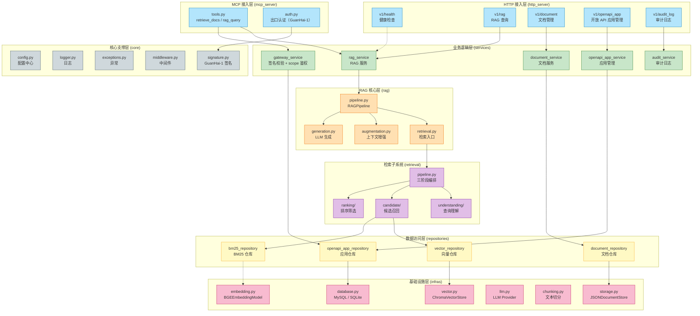
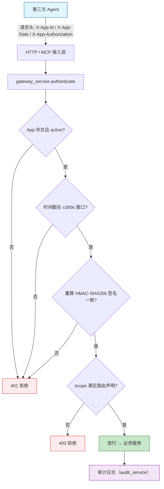

# x-GuanHai


[English](README.en.md) | 中文

## 💡 项目介绍

x-GuanHai（观海）是一个**支持 HTTP 与 MCP 双挂载的 RAG（检索增强生成）一体化工程框架**，遵循后端行业标准化工程实践，提供分层清晰、模块化、高可扩展、易维护的通用服务架构。

**核心价值**

- **双协议出口**：同一套服务同时挂载 HTTP API（`/api/v1`）与 MCP 服务（`/mcp`），第三方 Agent 可通过标准 MCP 协议动态发现并调用工具
- **机器身份安全**：面向第三方 Agent 提供纯程序调用鉴权（AppId + GuanHai-1 签名 + scope 最小授权），无自然人登录
- **分层架构**：标准三层业务架构 + 通用核心支撑层，完全与 Web 框架隔离，核心支撑层可复用在 RESTful API、MCP 工具、离线脚本、单元测试等全场景
- **OOP 检索流水线**：三阶段可插拔架构（查询理解、候选召回、排序筛选），每阶段均支持多种算法 Provider 灵活替换
- **多路召回**：稠密向量检索（Chroma ANN）+ 稀疏 BM25 关键词检索并行召回，RRF 融合 + MMR 多样性重排
- **多 LLM 支持**：DeepSeek、豆包、阿里云百炼、小米 Mimo 等主流 LLM 提供商
- **工程规范**：遵循 PEP8、完整类型注解、生产级日志与异常处理、CI/CD 与容器化部署

**适用场景**

- 企业知识库问答系统
- 智能客服与对话机器人
- 文档检索与摘要生成
- 多源数据融合检索平台
- RAG 技术学习与原型验证

## 🚀 快速开始

**1. 环境要求**

| 平台 | 要求 |
|------|------|
| **通用** | Python 3.11+、Git、[uv](https://github.com/astral-sh/uv)（推荐，非必要不使用 pip） |
| **Windows** | PowerShell 5.1+；已内置 `scripts/start.ps1` 启动脚本 |
| **Linux** | Ubuntu 20.04+ / CentOS 8+；已内置 `scripts/start.sh` 启动脚本 |
| **macOS** | macOS 12+；使用 Homebrew 安装 Python 与 uv |

**2. 项目代码克隆**

```bash
git clone https://github.com/chain-engine/x-GuanHai.git
cd x-GuanHai
```

**3. 依赖同步安装**

```bash
# 使用 uv 同步依赖（推荐）
uv sync

# 如需安装开发依赖
uv sync --group dev
```

**4. 环境配置**

项目支持 `.env` 环境变量与 `config.yaml` 配置文件两种方式，优先级：**环境变量 > config.yaml > 默认值**。

```bash
# 方式一：环境变量模板（推荐）
cp .env.example .env          # Windows PowerShell: Copy-Item .env.example .env

# 方式二：配置文件模板
cp config.yaml.example config.yaml
```

**核心配置参数说明**：

| 参数 | 说明 | 默认值 |
|------|------|--------|
| `DEEPSEEK_API_KEY` | LLM 提供商 API 密钥（DeepSeek/豆包/百炼/Mimo 均可配置） | 必填 |
| `EMBEDDING_MODEL` | 嵌入模型名称 | `BAAI/bge-m3` |
| `EMBEDDING_DEVICE` | 嵌入模型运行设备 | `cpu` |
| `VECTOR_STORE_PERSIST_DIR` | 向量数据库持久化目录 | `./data/chroma` |
| `TEXT_SPLITTER_STRATEGY` | 文本切分策略 | `recursive` |
| `GENERATION_PROVIDER` | LLM 生成提供商 | `deepseek` |
| `GENERATION_MODEL` | LLM 生成模型 | `deepseek-chat` |
| `OPENAPI_ENABLED` | 开放 API 鉴权开关（AppId + GuanHai-1 签名） | `true` |
| `OPENAPI_DB_URL` | 开放 API 认证数据库连接（默认 MySQL，本地可切 SQLite） | `mysql+pymysql://...` |
| `AUTH_SECRET_KEY` | 签名密钥加密密钥，**生产必须设置随机值** | 空（开发兜底） |
| `DEBUG` | 调试模式开关（true 时热重载） | `false` |

完整配置参数请参考 `.env.example` 与 `config.yaml` 中的注释说明。

**5. 服务启动**

*方式一：本地开发热重载启动（推荐）*

```bash
# 确保 .env 中 DEBUG=true
uv run x-GuanHai

# 或使用 uvicorn 直接启动
uv run uvicorn src.main:app --reload --host 0.0.0.0 --port 8000
```

*方式二：Docker 容器部署*

```bash
# 构建并启动
docker compose up -d

# 查看日志
docker compose logs -f

# 停止服务
docker compose down
```

*方式三：使用启动脚本*

```bash
# Windows
.\scripts\start.ps1

# Linux / macOS
./scripts/start.sh
```

服务启动后访问：

| 地址 | 说明 |
|------|------|
| http://localhost:8000/docs | Swagger 交互式 API 文档 |
| http://localhost:8000/redoc | ReDoc 只读 API 文档 |
| http://localhost:8000/openapi.json | OpenAPI JSON 规范文件 |
| http://localhost:8000/mcp | MCP Streamable HTTP 服务（第三方 Agent 接入点） |

**6. 常用工程命令**

```bash
# 单元测试（含覆盖率报告）
uv run pytest

# 代码格式化
uv run ruff format src/ tests/

# 静态代码检查
uv run ruff check src/ tests/

# 类型检查
uv run mypy src/

# 依赖漏洞扫描
uv audit

# 安装预提交钩子
uv run pre-commit install
```

**7. 使用方法示例**

*文档上传与 RAG 问答：*

```bash
# 1. 上传文档
curl -X POST http://localhost:8000/api/v1/documents/upload \
  -F "file=@your_document.pdf"

# 2. RAG 问答（检索 + 生成）
curl -X POST http://localhost:8000/api/v1/rag/query \
  -H "Content-Type: application/json" \
  -d '{"query": "你的问题"}'

# 3. 仅检索（不经过 LLM 生成）
curl -X POST http://localhost:8000/api/v1/rag/retrieve \
  -H "Content-Type: application/json" \
  -d '{"query": "检索关键词"}'
```

*开放 API 签名调用（第三方 Agent 接入）：*

```bash
# 1. 管理面创建应用（返回 AppKey 明文，仅一次）
python scripts/manage_openapi_app.py create --name my-agent --scopes rag:read document:read

# 2. 使用签名客户端调用（参考 examples/openapi_client.py）
export OPENAPI_APP_ID=gh_xxxxxxxx
export OPENAPI_APP_KEY=gk_xxxxxxxx
python examples/openapi_client.py rag/query --query "你的问题"
```

更多示例请参考 `examples/` 目录与 `docs/` 目录下的文档。

**8. 常见问题排查**

| 问题 | 解决方案 |
|------|----------|
| 端口 8000 被占用 | 修改 `.env` 中 `SERVER_PORT`，或 `netstat -ano \| findstr :8000` 定位进程 |
| `uv sync` 安装失败 | 确认网络可达镜像源（pyproject.toml 已配置阿里云镜像）；升级 uv：`uv self update` |
| 配置加载异常 | 确认 `.env` / `config.yaml` 存在且格式正确；配置优先级为环境变量 > config.yaml > 默认值 |
| 开放 API 数据库连接失败 | `OPENAPI_DB_URL` 指向的 MySQL 需提前建库（如 `CREATE DATABASE guanhai CHARACTER SET utf8mb4`）；本地调试可切换 `sqlite:///./data/openapi.db` |
| 嵌入模型下载缓慢/失败 | 首次运行需下载 BGE-M3 模型，可预先配置 `HF_ENDPOINT` 镜像或手动放置模型到缓存目录 |
| Windows 权限报错 | 以管理员运行 PowerShell，或执行 `Set-ExecutionPolicy -Scope CurrentUser RemoteSigned` |

## 📁 项目结构

```
x-GuanHai/
├── src/                              # 核心源码
│   ├── main.py                      # 应用入口（HTTP + MCP 双协议统一组装）
│   ├── http_server/                 # HTTP 接入层（与 mcp_server 平级对称）
│   │   ├── router.py                # 路由注册（health/rag/document/audit/openapi_app）
│   │   ├── dependencies.py          # 依赖管理（业务服务 + 开放 API 鉴权依赖）
│   │   ├── response.py              # 统一响应工具（success_response / error_response）
│   │   ├── scope_decorator.py       # 权限 scope 装饰器（声明路由所需 scope）
│   │   └── v1/                      # API v1 路由（health/rag/document/audit_log/openapi_app）
│   ├── mcp_server/                  # MCP 接入层（与 http_server 平级对称）
│   │   ├── server.py                # MCPServer 实例 + 三大原语统一注册入口
│   │   ├── tools.py                 # Tools 原语（retrieve_docs / rag_query，只读）
│   │   ├── prompts.py               # Prompts 原语（预留）
│   │   ├── resources.py             # Resources 原语（预留）
│   │   └── auth.py                  # MCP 出口认证中间件（与 HTTP 同源 GuanHai-1 签名）
│   ├── rag/                          # RAG 核心模块
│   │   ├── pipeline.py              # RAG 流水线编排（Retrieval→Augmentation→Generation）
│   │   ├── retrieval.py             # 检索入口
│   │   ├── augmentation.py          # 上下文增强
│   │   └── generation.py            # LLM 生成
│   ├── retrieval/                   # 检索子系统（OOP 三阶段）
│   │   ├── pipeline.py              # 检索流水线编排
│   │   ├── understanding/           # Stage 1 — 查询理解（预处理/意图/实体/重写/扩展）
│   │   ├── candidate/               # Stage 2 — 候选召回（向量 ANN / BM25 稀疏检索）
│   │   └── ranking/                 # Stage 3 — 排序筛选（RRF / MMR / 语义重排 / 阈值过滤）
│   ├── services/                    # 业务逻辑层（HTTP 与 MCP 共享）
│   │   ├── rag_service.py           # RAG 服务
│   │   ├── document_service.py      # 文档服务
│   │   ├── gateway_service.py  # 开放 API 网关鉴权（签名校验 + scope 校验）
│   │   ├── openapi_app_service.py      # 开放 API 应用管理（管理面）
│   │   └── audit_service.py         # 业务审计日志服务（独立事务，不阻断业务）
│   ├── repositories/                # 数据访问层
│   │   ├── vector_repository.py     # 向量仓库（Chroma）
│   │   ├── bm25_repository.py       # BM25 稀疏索引仓库
│   │   ├── document_repository.py   # 文档仓库（JSON）
│   │   ├── openapi_app_repository.py # 开放 API 应用仓库
│   │   └── audit_log_repository.py  # 审计日志仓库
│   ├── models/                      # ORM 实体层（openapi_app / openapi_scope / audit_log）
│   ├── infras/                      # 基础设施层
│   │   ├── database.py              # 数据库（Provider 抽象：MySQL 默认 / SQLite 回退）
│   │   ├── storage.py               # 文档存储（抽象基类 + JSON 实现）
│   │   ├── embedding.py             # 嵌入模型（抽象基类 + BGE-M3 实现）
│   │   ├── vector.py                # 向量存储（抽象基类 + Chroma 实现）
│   │   ├── bm25.py                  # BM25 稀疏索引存储
│   │   ├── chunking.py              # 文本切分（LangChain / LlamaIndex Provider）
│   │   └── llm.py                   # LLM 提供商（抽象基类 + OpenAI 兼容实现）
│   ├── core/                        # 核心支撑层
│   │   ├── config.py                # 配置中心（环境变量 + YAML）
│   │   ├── logger.py                # 日志模块（Loguru）
│   │   ├── exceptions.py            # 异常定义
│   │   ├── middleware.py            # 中间件（CORS/限流/请求追踪）
│   │   └── signature.py             # GuanHai-1 签名协议（纯函数）
│   ├── constants/                   # 常量与枚举（含 OpenApiScopeCode scope 目录）
│   ├── schemas/                     # 数据模型（Pydantic）
│   └── utils/                       # 工具函数（security/openapi/similarity/filters）
├── tests/                            # 测试用例（unit / integration / api）
├── examples/                         # 示例代码（openapi_client.py 等）
├── scripts/                          # 运维脚本（start.ps1 / start.sh / manage_openapi_app.py）
├── docs/                             # 项目文档（架构设计、检索流水线、Postman 集合）
├── data/                             # 运行时数据（向量库、文档库、BM25 索引）
├── logs/                             # 运行日志
├── .github/workflows/                # GitHub Actions CI/CD
├── .pre-commit-config.yaml           # Pre-commit 配置
├── config.yaml / config.yaml.example # 配置文件（模板）
├── .env.example                      # 环境变量模板
├── docker-compose.yml                # Docker 编排
├── Dockerfile                        # Docker 镜像（多阶段构建）
├── pyproject.toml                    # 项目配置（uv / ruff / mypy / pytest）
├── CHANGELOG.md                      # 变更日志
├── LICENSE                           # MIT 协议
└── README.md                         # 本文档
```

## 🏗️ 系统架构

**分层架构图**



**核心业务流程：检索流水线**


**核心业务流程：开放 API 签名鉴权**



**关键技术组件说明**

| 组件 | 说明 |
|------|------|
| RAG 流水线 | `Retrieval → Augmentation → Generation` 三阶段编排，检索结果与用户问题拼接为上下文后交由 LLM 生成 |
| 检索流水线 | OOP 三阶段：查询理解（预处理/意图/实体/重写/扩展）→ 候选召回（向量 ANN + BM25）→ 排序筛选（RRF/MMR/阈值） |
| 开放 API 鉴权 | AppId + GuanHai-1 HMAC 签名 + scope 最小授权；时间窗 ±300s；管理面（keys/audit）需 admin scope |
| MCP 服务 | MCP Python SDK Streamable HTTP 传输，挂载 `/mcp`；`retrieve_docs` / `rag_query` 只读工具复用 RAG 服务实例；认证中间件将应用身份透传为 operator 供审计 |
| 审计服务 | 读/写操作审计：写操作（上传/删除/创建/吊销/启停）与业务读操作（文档查询/统计/应用列表）均记录，独立事务不阻断业务；探活类接口（health/status）不记；MCP 侧调用同样落 operator |
| 配置中心 | 环境变量 > config.yaml > 默认值三级优先级 |

## 🛠️ 技术栈

| 类别 | 技术 |
|------|------|
| **开发语言** | Python 3.11+ |
| **Web 框架** | FastAPI + Uvicorn |
| **MCP 服务** | MCP Python SDK（Streamable HTTP，/mcp） |
| **数据存储** | Chroma（向量数据库）、SQLAlchemy（MySQL 默认 / SQLite 回退）、JSON 文件（文档元数据）、BM25（稀疏索引） |
| **嵌入模型** | BGE-M3（智源开源） |
| **LLM** | DeepSeek / 豆包 / 阿里云百炼 / 小米 Mimo（OpenAI 兼容接口） |
| **文本切分** | LangChain / LlamaIndex Provider |
| **安全** | HMAC-SHA256、Fernet（AppKey 加密）、scope 权限模型 |
| **日志** | Loguru |
| **核心工具库** | Pydantic、httpx、rank-bm25、python-jose、passlib |
| **容器化** | Docker（多阶段构建）、docker-compose |
| **CI/CD** | GitHub Actions |
| **包管理** | uv |
| **代码规范** | Ruff（格式化 + Lint）、mypy（类型检查）、black、pre-commit |

## 📚 API 文档说明

服务启动后，可通过以下地址访问接口文档：

| 文档类型 | 访问地址 | 说明 |
|----------|----------|------|
| **Swagger UI** | http://localhost:8000/docs | 交互式 API 文档，支持在线调试 |
| **ReDoc** | http://localhost:8000/redoc | 只读 API 文档，适合阅读参考 |
| **OpenAPI JSON** | http://localhost:8000/openapi.json | OpenAPI 3.x 规范文件，可导入 Postman 等工具 |
| **MCP 端点** | http://localhost:8000/mcp | MCP Streamable HTTP，支持 `initialize` / `tools/list` |

**核心接口清单**：

| 模块 | 方法 | 路径 | 说明 | 权限 |
|------|------|------|------|------|
| 系统 | `GET` | `/api/v1/health` | 健康检查 | 公开 |
| 系统 | `GET` | `/api/v1/version` | 版本信息 | 公开 |
| 系统 | `GET` | `/api/v1/status` | 系统运行状态 | 公开 |
| RAG | `POST` | `/api/v1/rag/query` | RAG 问答（检索 + 生成） | 签名 + `rag:read` |
| RAG | `POST` | `/api/v1/rag/retrieve` | 仅检索（不经过 LLM） | 签名 + `rag:read` |
| RAG | `POST` | `/api/v1/rag/embed` | 文本向量化 | 签名 + `rag:read` |
| RAG | `GET` | `/api/v1/rag/stats` | 向量库统计信息 | 签名 + `rag:read` |
| 文档 | `POST` | `/api/v1/documents/upload` | 上传文档 | 签名 + `document:write` |
| 文档 | `GET` | `/api/v1/documents` | 文档列表 | 签名 + `document:read` |
| 文档 | `GET` | `/api/v1/documents/{id}` | 获取文档详情 | 签名 + `document:read` |
| 文档 | `DELETE` | `/api/v1/documents/{id}` | 删除文档 | 签名 + `document:write` |
| 文档 | `GET` | `/api/v1/documents/{id}/status` | 文档处理状态 | 签名 + `document:read` |
| 开放 API 应用管理 | `GET` | `/api/v1/apps` | 应用列表 | 签名 + `admin` |
| 开放 API 应用管理 | `POST` | `/api/v1/apps` | 创建应用（返回明文 AppKey，仅一次） | 签名 + `admin` |
| 开放 API 应用管理 | `DELETE` | `/api/v1/apps/{app_id}` | 吊销应用 | 签名 + `admin` |
| 开放 API 应用管理 | `POST` | `/api/v1/apps/{app_id}/enable` | 重新启用应用 | 签名 + `admin` |
| 开放 API 应用管理 | `DELETE` | `/api/v1/apps/{app_id}/purge` | 物理删除应用 | 签名 + `admin` |
| 审计 | `GET` | `/api/v1/audit/logs` | 审计日志列表 | 签名 + `admin` |
| 审计 | `GET` | `/api/v1/audit/logs/{log_id}` | 审计日志详情 | 签名 + `admin` |

**权限控制说明**：

- **鉴权模型**：面向第三方 Agent 的纯机器身份认证（AppId + GuanHai-1 HMAC 签名），无自然人登录
- **签名协议**：请求头携带 `X-App-Id` / `X-App-Date`（RFC1123 GMT）/ `X-App-Authorization`（`GuanHai-1 {app_id}:{signature}`），签名基于 AppKey 对请求方法、URI、Content-Type、时间戳、Body SHA256 计算 HMAC-SHA256；时间窗 ±300 秒防重放
- **scope 最小授权**：6 个 scope 枚举（`rag:read` / `document:read` / `document:write` / `admin`），双声明鉴权（路由 Depends + 装饰器），启动时自动对账同步 scope 目录
- **密钥管理**：AppKey 以 Fernet 加密存储，明文仅创建时返回一次；应用可吊销/启用/物理删除
- **MCP 鉴权**：`/mcp` 出口认证与 HTTP 同源（GuanHai-1 签名），复用同一套应用与 scope 体系

## 💾 存储配置说明

项目采用**混合存储**：向量数据存 Chroma、文档元数据存 JSON 文件、稀疏索引存 BM25、开放 API 认证数据存关系型数据库（MySQL 默认 / SQLite 回退）。

**向量存储（Chroma）**

| 配置项 | 配置参数 | 默认值 | 说明 |
|--------|---------|--------|------|
| 持久化目录 | `VECTOR_STORE_PERSIST_DIR` | `./data/chroma` | 向量数据库本地持久化路径 |
| 集合名称 | `VECTOR_STORE_COLLECTION_NAME` | `documents` | Chroma Collection 名称 |
| 距离类型 | `VECTOR_STORE_DISTANCE` | `cosine` | 向量距离度量方式（cosine / l2 / ip） |

**文档存储（JSON）**

文档元数据以 JSON 文件形式存储在 `./data/documents/` 目录下，支持文档 CRUD 与状态追踪（每文档一个文件，含文档 ID、文件名、上传时间、处理状态、切片数量等元数据）。

**BM25 稀疏索引存储**

| 配置项 | 说明 |
|--------|------|
| 存储路径 | `./data/bm25/` |
| 索引名称 | `documents` |
| 用途 | 稀疏关键词检索的 BM25 索引持久化 |

**开放 API 认证数据库（SQLAlchemy）**

| 配置项 | 配置参数 | 默认值 | 说明 |
|--------|---------|--------|------|
| 连接串 | `OPENAPI_DB_URL` | MySQL（生产） | 默认 `mysql+pymysql://...`；本地调试可切换 `sqlite:///./data/openapi.db` |
| 数据表 | openapi_apps / openapi_scopes | — | 应用注册表（AppId/AppKey 密文/scope/状态）+ scope 目录表 |
| 签名时间窗 | `OPENAPI_SIGNATURE_WINDOW_SECONDS` | `300` | 防重放时间窗（秒） |
| 限流 | `OPENAPI_DEFAULT_RATE_LIMIT_PER_MINUTE` | `60` | 单应用每分钟调用上限 |

## 📄 许可证

本项目基于 [MIT License](./LICENSE) 开源。

## 📖 参考资料

- [Python 官方文档](https://docs.python.org/3.11/)
- [uv 官方文档](https://github.com/astral-sh/uv)
- [FastAPI 官方文档](https://fastapi.tiangolo.com/)
- [MCP 官方文档](https://modelcontextprotocol.io/)
- [Chroma 官方文档](https://docs.trychroma.com/)
- [BGE-M3 官方文档](https://github.com/FlagOpen/FlagEmbedding)
- [SQLAlchemy 官方文档](https://docs.sqlalchemy.org/)
- [Pydantic 官方文档](https://docs.pydantic.dev/)
- [rank-bm25 官方文档](https://github.com/dorianbrown/rank_bm25)
- [LangChain 官方文档](https://python.langchain.com/)
- [Loguru 官方文档](https://github.com/Delgan/loguru)
- [Docker 官方文档](https://docs.docker.com/)

## 📬 联系方式

- **作者**：John Young（夜雨诗来）
- **邮箱**：john.young@foxmail.com
- **Gitee**：https://gitee.com/yeyushilai
- **GitHub**：https://github.com/yeyushilai
- **项目地址**：https://github.com/chain-engine/x-GuanHai
