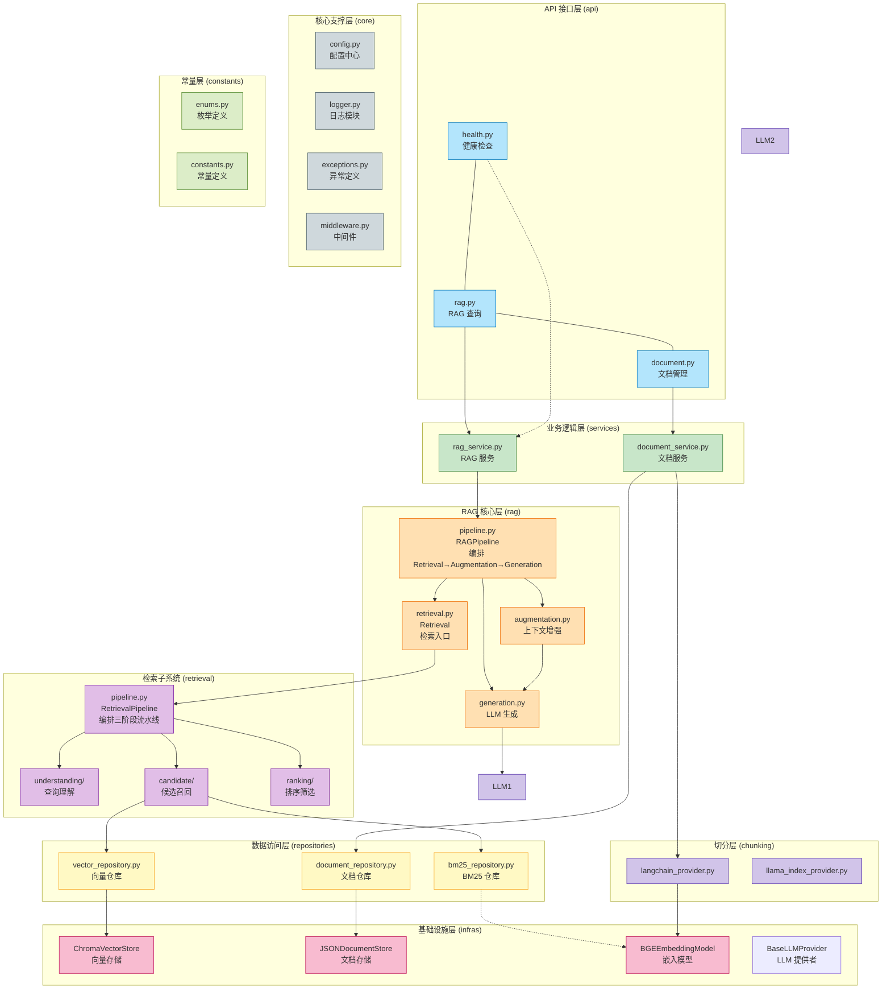
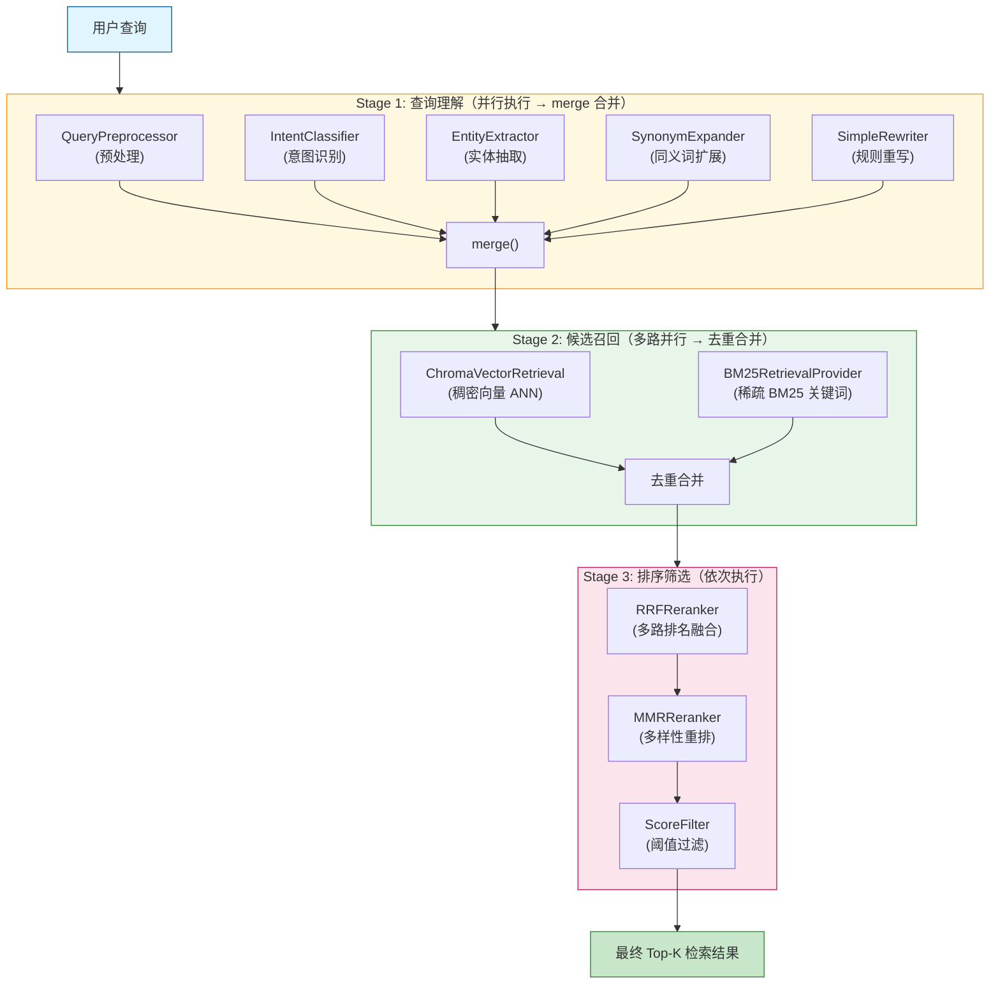
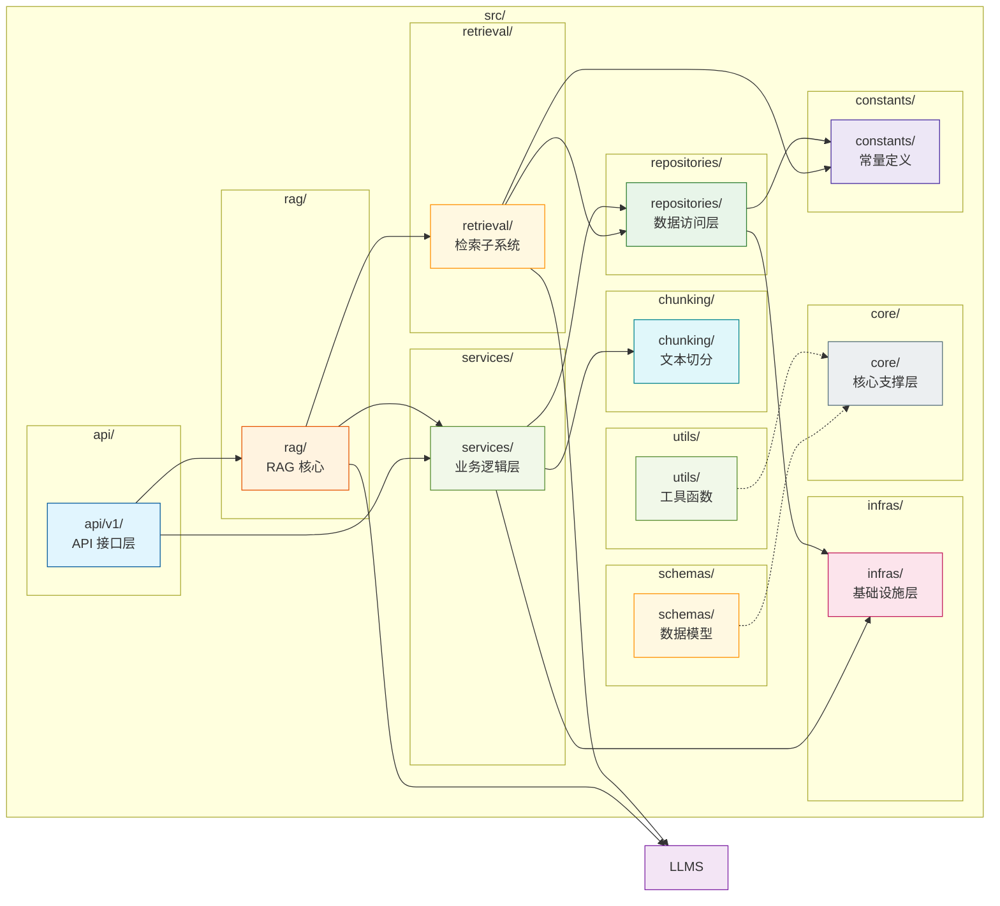
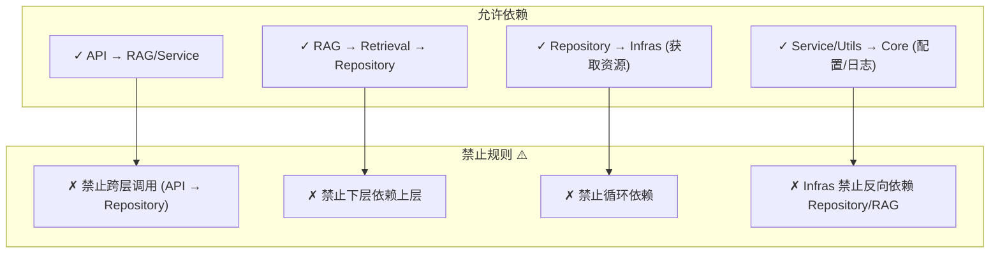

# x-GuanHai

[](https://opensource.org/licenses/MIT)
[](https://www.python.org/downloads/)
[](https://github.com/astral-sh/ruff)

[English](README.en.md) | 中文

## 项目简介

x-GuanHai（观海）是**一个生产级 RAG（检索增强生成）一体化工程框架**，遵循后端行业标准化工程实践，提供分层清晰、模块化、高可扩展、易维护的通用服务架构。

### 核心价值

- **分层架构**：标准五层业务架构 + 通用核心支撑层，完全与 Web 框架隔离
- **模块化设计**：核心支撑层可复用在 RESTful API、定时任务、消息消费、离线脚本、单元测试等全场景
- **开箱即用**：支持多环境切换、容器化部署，可快速搭建企业级 RESTful API 后端服务
- **工程规范**：遵循 PEP8、完整类型注解、生产级日志与异常处理

### 核心特征

- **OOP 检索流水线**：三阶段可插拔架构（查询理解、候选召回、排序筛选），每阶段均支持多种算法 Provider 灵活替换
- **查询预处理**：归一化、去停用词、标点处理，为后续阶段提供干净的输入
- **意图识别**：基于规则识别 7 种查询意图类型（事实型、观点型、列表型、定义型、比较型、因果型、操作型），支撑下游路由决策
- **实体抽取**：正则 + 词典双模式 NER，抽取时间、数字、地点、技术术语等实体
- **多路召回**：稠密向量检索（Chroma ANN）+ 稀疏 BM25 关键词检索，并行召回取长补短
- **RRF + MMR 排序**：RRF 融合多路召回结果后，再经 MMR 多样性重排，兼顾相关性与多样性
- **灵活切分**：提供字符级、单词级、句子级、段落级、语义级等多种文本切分策略
- **多 LLM 支持**：支持 DeepSeek、豆包、阿里云百炼、小米 Mimo 等主流 LLM 提供商
- **中间件支持**：CORS、限流、请求追踪、统一异常处理

### 适配场景

- 企业知识库问答系统
- 智能客服与对话机器人
- 文档检索与摘要生成
- 多源数据融合检索平台
- RAG 技术学习与原型验证

## 2. 快速开始

### 2.1 环境要求

| 平台 | 要求 |
|------|------|
| **通用** | Python 3.11+、Git |
| **Windows** | 推荐使用 PowerShell 5.1+，已内置 `scripts/start.ps1` 启动脚本 |
| **Linux** | 推荐 Ubuntu 20.04+ / CentOS 8+，已内置 `scripts/start.sh` 启动脚本 |
| **macOS** | 推荐 macOS 12+，使用 Homebrew 安装 Python |

> 包管理工具推荐 [uv](https://github.com/astral-sh/uv)（高性能 Python 包管理器），非必要不使用 pip。

### 2.2 项目代码克隆

```bash
git clone https://github.com/chain-engine/x-GuanHai.git
cd x-GuanHai
```

### 2.3 依赖同步安装

```bash
# 使用 uv 同步依赖（推荐）
uv sync

# 如需安装开发依赖
uv sync --group dev
```

### 2.4 环境配置

项目支持 `.env` 环境变量和 `config.yaml` 配置文件两种方式，优先级：**环境变量 > config.yaml > 默认值**。

```bash
# 复制环境变量模板
cp .env.example .env
```

**核心配置参数说明**：

| 参数 | 说明 | 默认值 |
|------|------|--------|
| `DEEPSEEK_API_KEY` | DeepSeek API 密钥 | 必填 |
| `EMBEDDING_MODEL` | 嵌入模型名称 | `BAAI/bge-m3` |
| `EMBEDDING_DEVICE` | 嵌入模型运行设备 | `cpu` |
| `VECTOR_STORE_PERSIST_DIR` | 向量数据库持久化目录 | `./data/chroma` |
| `GENERATION_PROVIDER` | LLM 生成提供商 | `deepseek` |
| `GENERATION_MODEL` | LLM 生成模型 | `deepseek-chat` |
| `GENERATION_TEMPERATURE` | 生成温度 | `0.7` |
| `DEBUG` | 调试模式开关 | `true` |
| `LOG_LEVEL` | 日志级别 | `INFO` |

完整的配置参数请参考 `config.yaml` 文件中的注释说明。

### 2.5 服务启动

**方式一：本地开发热重载启动（推荐）**

```bash
# 确保 .env 中 DEBUG=true
uv run x-GuanHai

# 或使用 uvicorn 直接启动
uv run uvicorn src.main:app --reload --host 0.0.0.0 --port 8000
```

**方式二：Docker 容器部署**

```bash
# 构建并启动
docker-compose up -d

# 查看日志
docker-compose logs -f

# 停止服务
docker-compose down
```

**方式三：使用启动脚本**

```bash
# Windows
.\scripts\start.ps1

# Linux / macOS
./scripts/start.sh
```

服务启动后访问：

| 地址 | 说明 |
|------|------|
| http://localhost:8000/docs | Swagger 交互式 API 文档 |
| http://localhost:8000/redoc | ReDoc 只读 API 文档 |
| http://localhost:8000/openapi.json | OpenAPI JSON 规范文件 |

### 2.6 常用工程命令

```bash
# 运行单元测试
uv run pytest tests/

# 运行测试并生成覆盖率报告
uv run pytest tests/ --cov=src --cov-report=html

# 代码格式化
uv run ruff format src/

# 静态代码检查
uv run ruff check src/ --fix

# 类型检查
uv run mypy src/

# 安装预提交钩子
uv run pre-commit install
```

### 2.7 使用方法示例

**文档上传与问答流程**：

```bash
# 1. 上传文档
curl -X POST http://localhost:8000/api/v1/documents/upload \
  -F "file=@your_document.pdf"

# 2. RAG 问答
curl -X POST http://localhost:8000/api/v1/rag/query \
  -H "Content-Type: application/json" \
  -d '{"query": "你的问题"}'

# 3. 仅检索（不经过 LLM 生成）
curl -X POST http://localhost:8000/api/v1/rag/retrieve \
  -H "Content-Type: application/json" \
  -d '{"query": "检索关键词"}'
```

更多示例请参考 `examples/` 目录下的示例代码。

## 项目结构

```
x-GuanHai/
├── src/                          # 核心源码
│   ├── api/                      # API 接口层
│   │   ├── router.py            # 路由注册
│   │   └── v1/                  # API v1 版本
│   │       ├── health.py         # 健康检查
│   │       ├── rag.py           # RAG 接口
│   │       └── document.py       # 文档管理
│   ├── rag/                      # RAG 核心模块
│   │   ├── pipeline.py          # RAG 流水线编排
│   │   ├── retrieval.py         # 检索入口（委托 Pipeline）
│   │   ├── augmentation.py     # 上下文增强
│   │   └── generation.py        # LLM 生成
│   ├── retrieval/               # 检索子系统（OOP 三阶段）
│   │   ├── pipeline.py         # 检索流水线编排
│   │   ├── understanding/       # Stage 1 — 查询理解
│   │   │   ├── base.py         # 抽象基类
│   │   │   ├── preprocess.py   # 查询预处理（归一化/去停用词）
│   │   │   ├── intent.py       # 意图识别（7 种意图类型）
│   │   │   ├── entity.py       # 实体抽取（NER）
│   │   │   ├── rewrite.py      # 查询重写
│   │   │   └── expansion.py    # 查询扩展（同义词/向量）
│   │   ├── candidate/           # Stage 2 — 候选召回
│   │   │   ├── base.py         # 抽象基类
│   │   │   ├── vector_retrieval.py  # 向量 ANN 检索（Chroma）
│   │   │   ├── keyword_retrieval.py # 关键词检索抽象
│   │   │   └── bm25_retrieval.py    # BM25 稀疏检索
│   │   └── ranking/             # Stage 3 — 排序筛选
│   │       ├── base.py         # 抽象基类
│   │       ├── mmr.py          # MMR 多样性重排
│   │       ├── rrf.py          # RRF 排名融合
│   │       ├── semantic.py     # 语义重排
│   │       └── score_filter.py # 分值阈值过滤
│   ├── chunking/                # 文本切分
│   │   ├── base.py            # 切分抽象基类
│   │   ├── langchain_provider.py  # LangChain 切分
│   │   └── llama_index_provider.py  # LlamaIndex 切分
│   ├── services/                # 业务逻辑层
│   │   ├── base_service.py      # 服务基类
│   │   ├── rag_service.py      # RAG 服务
│   │   └── document_service.py  # 文档服务
│   ├── repositories/            # 数据访问层
│   │   ├── base_repository.py   # 基础仓库类
│   │   ├── vector_repository.py # 向量仓库
│   │   ├── bm25_repository.py   # BM25 仓库
│   │   └── document_repository.py # 文档仓库
│   ├── models/                  # ORM 实体层
│   │   ├── base.py            # 实体基类
│   │   ├── document.py        # 文档实体
│   │   └── vector.py          # 向量记录
│   ├── infras/                 # 基础设施层
│   │   ├── storage.py         # 文档存储（抽象基类 + JSON实现）
│   │   ├── embedding.py       # 嵌入模型（抽象基类 + BGE-M3实现）
│   │   ├── vector.py          # 向量存储（抽象基类 + Chroma实现）
│   │   └── bm25.py            # BM25 稀疏索引存储
│   ├── core/                   # 核心支撑层
│   │   ├── config.py          # 配置中心
│   │   ├── logger.py          # 日志模块
│   │   ├── exceptions.py      # 异常定义
│   │   └── middleware.py      # 中间件（CORS/限流/追踪）
│   ├── schemas/                 # 数据模型（Pydantic）
│   │   ├── base.py            # Schema 基类
│   │   ├── rag.py            # RAG 相关 Schema
│   │   ├── document.py       # 文档相关 Schema
│   │   ├── health.py         # 健康检查 Schema
│   │   └── responses.py      # 统一响应格式
│   ├── constants/               # 常量定义
│   │   ├── base.py            # 枚举基类族（BaseEnum/StrBaseEnum/IntBaseEnum/FloatBaseEnum）
│   │   ├── enums.py           # 枚举定义
│   │   └── constants.py       # 常量定义
│   ├── utils/                   # 工具函数
│   │   ├── similarity.py      # 相似度计算引擎
│   │   ├── filters.py        # 元数据过滤引擎
│   │   └── index_optimizer.py  # 向量索引优化
│   └── main.py                 # 应用入口
├── tests/                        # 测试用例
├── examples/                     # 示例代码
├── scripts/                      # 运维脚本（start.sh / start.ps1 / format.sh / format.ps1）
├── docs/                         # 项目文档（架构设计、检索流水线文档）
├── data/                         # 运行时数据（向量库、文档库、BM25 索引）
├── logs/                         # 运行日志
├── .github/workflows/            # GitHub Actions CI/CD
├── .pre-commit-config.yaml    # Pre-commit 配置
├── config.yaml                 # 配置文件
├── .env.example                # 环境变量模板
├── docker-compose.yml          # Docker 编排
├── Dockerfile                  # Docker 镜像
├── pyproject.toml             # 项目配置（uv）
├── CHANGELOG.md              # 变更日志
├── LICENSE                    # MIT 协议
└── README.md                 # 本文档
```

## 系统架构

### 分层架构图



### 检索流水线架构（核心亮点）



### 模块依赖关系图



### 依赖规则说明



## 技术栈

| 类别 | 技术 |
|------|------|
| **Web 框架** | FastAPI + Uvicorn |
| **数据存储** | Chroma（向量数据库） |
| **嵌入模型** | BGE-M3（智源开源） |
| **LLM** | DeepSeek / 豆包 / 阿里云百炼 / 小米 Mimo |
| **文本切分** | LangChain / LlamaIndex |
| **日志** | Loguru |
| **核心工具库** | Pydantic、httpx、rank-bm25 |
| **容器化** | Docker、docker-compose |
| **CI/CD** | GitHub Actions |
| **包管理** | uv |
| **代码规范** | Ruff（格式化 + Lint）、mypy（类型检查）、pre-commit |

## API 文档说明

服务启动后，可通过以下地址访问接口文档：

| 文档类型 | 访问地址 | 说明 |
|----------|----------|------|
| **Swagger UI** | http://localhost:8000/docs | 交互式 API 文档，支持在线调试 |
| **ReDoc** | http://localhost:8000/redoc | 只读 API 文档，适合阅读参考 |
| **OpenAPI JSON** | http://localhost:8000/openapi.json | OpenAPI 3.x 规范文件，可导入 Postman 等工具 |

### 接口概览

| 模块 | 方法 | 路径 | 说明 |
|------|------|------|------|
| 健康检查 | `GET` | `/api/v1/health` | 系统健康状态 |
| 健康检查 | `GET` | `/api/v1/version` | 版本信息 |
| 健康检查 | `GET` | `/api/v1/status` | 系统运行状态 |
| 文档管理 | `POST` | `/api/v1/documents/upload` | 上传文档 |
| 文档管理 | `GET` | `/api/v1/documents` | 列出文档 |
| 文档管理 | `GET` | `/api/v1/documents/{id}` | 获取文档详情 |
| 文档管理 | `DELETE` | `/api/v1/documents/{id}` | 删除文档 |
| 文档管理 | `GET` | `/api/v1/documents/{id}/status` | 文档处理状态 |
| RAG 查询 | `POST` | `/api/v1/rag/query` | RAG 问答（检索 + 生成） |
| RAG 查询 | `POST` | `/api/v1/rag/retrieve` | 仅检索（不经过 LLM） |
| RAG 查询 | `POST` | `/api/v1/rag/embed` | 文本向量化 |
| RAG 查询 | `GET` | `/api/v1/rag/stats` | 向量库统计信息 |

## 存储配置说明

本项目使用 **Chroma 向量数据库**作为向量存储后端，使用 **JSON 文件**作为文档元数据存储。

### 向量存储（Chroma）

| 配置项 | 配置文件参数 | 默认值 | 说明 |
|--------|-------------|--------|------|
| 持久化目录 | `vector_store.persist_directory` | `./data/chroma` | 向量数据库本地持久化路径 |
| 集合名称 | `vector_store.collection_name` | `documents` | Chroma Collection 名称 |
| 距离类型 | `vector_store.distance` | `cosine` | 向量距离度量方式（cosine / l2 / ip） |

### 文档存储（JSON）

文档元数据以 JSON 文件形式存储在 `./data/documents/` 目录下，支持文档的 CRUD 操作和状态追踪。

| 配置项 | 说明 |
|--------|------|
| 存储路径 | `./data/documents/` |
| 格式 | JSON 文件，每个文档一个文件 |
| 内容 | 文档 ID、文件名、上传时间、处理状态、切片数量等元数据 |

### BM25 索引存储

| 配置项 | 说明 |
|--------|------|
| 存储路径 | `./data/bm25/` |
| 索引名称 | `documents` |
| 用途 | 稀疏关键词检索的 BM25 索引持久化 |

## 许可证

本项目基于 [MIT License](./LICENSE) 开源。

## 参考资料

- [Python 官方文档](https://docs.python.org/3.11/)
- [FastAPI 官方文档](https://fastapi.tiangolo.com/)
- [uv 官方文档](https://github.com/astral-sh/uv)
- [Chroma 官方文档](https://docs.trychroma.com/)
- [BGE-M3 官方文档](https://github.com/FlagOpen/FlagEmbedding)
- [Pydantic 官方文档](https://docs.pydantic.dev/)
- [rank-bm25 官方文档](https://github.com/dorianbrown/rank_bm25)
- [LangChain 官方文档](https://python.langchain.com/)
- [Loguru 官方文档](https://github.com/Delgan/loguru)
- [Docker 官方文档](https://docs.docker.com/)

## 联系方式

- **作者**：John Young（夜雨诗来）
- **邮箱**：john.young@foxmail.com
- **Gitee**：https://gitee.com/yeyushilai
- **GitHub**：https://github.com/yeyushilai
- **项目地址**：https://github.com/chain-engine/x-GuanHai
